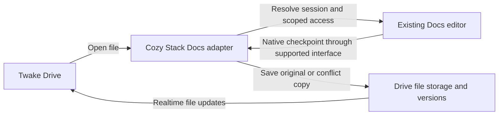
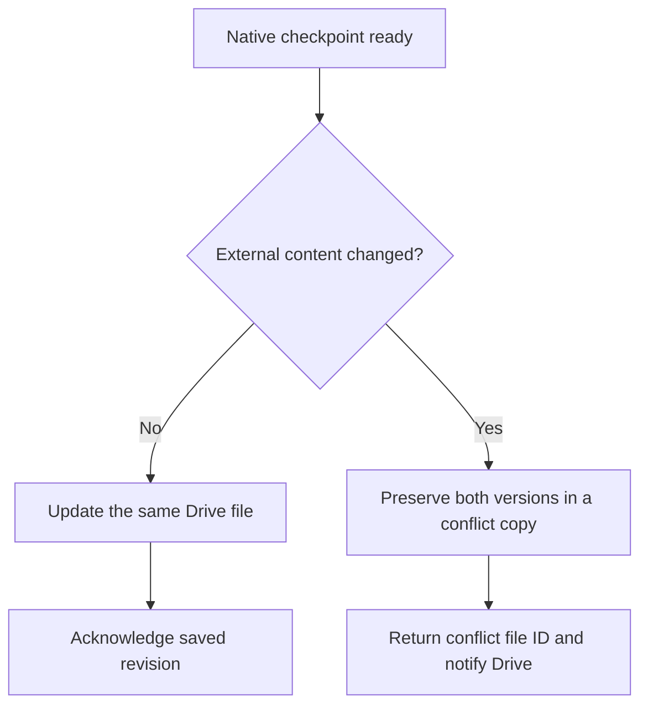

# Integrate Docs as a Stack-managed editor for Drive files

## Decision TLDR;

**Make Cozy Stack own the Docs integration, as it does for OnlyOffice.** Drive
opens the editor; Stack manages file access, editor sessions and saving back to
the original file; Docs provides its existing editing and collaboration engine.
Prefer changes in Stack and Drive. Change Docs only for an indispensable missing
integration capability, through a small, reusable interface.

## Status

Proposed, revised after isolated integration work. This is a target architecture,
not an accepted team decision or an implemented end-to-end save-back path. The
prototype and local qualification branches described below are not deployment.
It proposes replacing the experimental new-copy model as the product direction.
No existing files, drafts or deployments are migrated by this ADR.

## Context

The experiment established native Docs editing and verified creation of a Drive
copy. It also placed Cozy-specific OAuth, permissions, receipts and session
controls inside Docs. Extending that arrangement would make Docs increasingly
responsible for Drive concerns.

OnlyOffice provides a closer model for the desired product: Stack authorizes
opening, identifies a shared editing session, receives the edited content and
writes it through the file system. Normal saves update the original; conflicts
can produce another file. Drive supplies navigation, sharing and recovery UI.

The design preference is therefore **platform integration over a Docs fork**.
Reuse Docs, including its native UI and Yjs collaboration, rather than teaching
its editor how Cozy files and shared drives work.

## Decision

### Ownership

| Responsibility | Owner |
| --- | --- |
| File identity, effective permissions, owner-instance routing and sharing | Stack |
| File-to-Docs-session mapping, save-back, conflict handling and recovery records | Stack Docs adapter |
| Open action, editor navigation, sharing UI and save/conflict feedback | Drive |
| Editing, live document state, coediting and consistent native snapshots/media | Docs |

Build a Docs-specific adapter in Stack, reusing existing file, sharing and version
facilities. Do not build a general editor framework or reproduce the OnlyOffice
wire protocol: Docs is not an OnlyOffice Document Server.

### Open the authoritative file, not a recipient's independent copy

Drive asks Stack to open a selected file. Stack resolves the owning instance,
checks effective read/write access and selects or creates the corresponding Docs
editing session. Concurrent opens of the same file/version join the same live
Docs document rather than importing a new independent draft per user.

Drive launches the native Docs editor using a supported integration/identity
mechanism. Prefer an embedded editor when supported; a top-level launch is
acceptable without forking its UI just to obtain an iframe. Reuse existing
bridge/authentication capabilities first. Keep sharing in Drive: independent Docs
sharing controls must not grant access outside Stack, using existing configuration
or a narrow integration option. Docs must enforce the resulting editor access,
including read-only mode and revocation, not merely hide controls in Drive.

### Save back to the same file; copy only when needed

The intended user experience is **autosave/save to the original Drive file**.
Docs owns live editing state; Drive stores the latest acknowledged native
checkpoint. Reopening must use the mapped active session or the latest persisted
checkpoint, never silently replace newer edits with an older snapshot.

The Stack adapter obtains a consistent snapshot through a supported Docs
interface, including the referenced media, and writes it through the normal VFS.
An acknowledgment identifies the persisted file revision/checkpoint. Editing
state alone is not evidence that the Drive file has been saved.

Prefer an existing Docs checkpoint notification. If none exists, first assess
Stack-side checkpointing through a supported snapshot interface; introduce a
small Docs hook only when required. Save cadence and transport are implementation
choices to validate, not an assumption that Docs already sends OnlyOffice-style
callbacks. Browser closure must not be the only persistence trigger.

Before replacing content, Stack checks the base revision and content identity:

A rename alone need not create a conflict in the target design. The current
experimental Stack primitive instead rejects any revision change, including a
rename; relaxing that requires a separately validated content-identity policy.
Retries for the same checkpoint must
not create duplicate revisions or conflict files. If access is revoked, the file
is deleted or storage fails, report an unsaved/error state and retain recoverable
editing state; do not silently recreate the original or announce success.
Conflict-copy creation must itself be authorized and must not broaden sharing.

Use Drive's existing version history and retention policy for persisted content.
This is file history, not a promise to expose every Yjs operation or native Docs
history entry. Drive's realtime/cache path should reflect saves without a separate
manual polling system in the UI.

### Keep Docs changes small and upstream-compatible

Use configuration and supported Docs interfaces before adding code to Docs.
The minimum capabilities to verify are:

- opening or rejoining a native document with the intended editor access;
- importing and exporting consistent native state with independent media;
- obtaining a checkpoint identity and enforcing access changes on active sessions.

If an essential capability is missing, add a narrow, reusable Docs interface for
it. Do not move Stack permission rules, VFS writes, Drive file naming, conflict
policy or sharing UI into Docs. Do not read Docs databases/object storage directly
to manufacture snapshots, or rely on DOM patches and private editor internals.

The experimental `/cozy` page is a proof of feasibility, not the new product
entry point. Its native-package work can inform the adapter, but its singleton,
source allowlist, dedicated copies folder and per-document Cozy OAuth UI are not
the target architecture.

### Preserve existing routes and file identities

Drive already routes `.docs-note` references with `metadata.externalId` to the
Docs app's `/bridge/docs/<id>` route. These references are not the experimental
`.docs` native archives. Reuse that bridge where appropriate, but do not assume it
already implements native import/export or Drive save-back. Save-back applies to
native document files; a `.docs-note` pointer must not silently become a binary
archive. Preserve existing routing and decide any convergence explicitly.

The experimental Stack/native work uses `.docs-note2` for native packages;
that proposed format is distinct from both existing `.docs-note` pointers and
the earlier `.docs` experiment. Its production routing and migration are not
established.

The mobile client uses the same `.docs-note`/external-ID bridge and opens Office
through Drive's web editor route. Keep the Stack contract usable by both clients;
this ADR does not require a separate mobile editor implementation.

## Evidence since the initial proposal

The following results are local, isolated qualifications, not a claim that the
integrated product is available:

- **Earlier prototype:** the Docs-side `/cozy` experiment demonstrated native
  editing and creation of a separate Drive copy. Historical package/image,
  reopen and reload evidence crossed browser profiles; a later UI reopening was
  owner-reported. A requested fresh uninterrupted same-profile roundtrip stopped
  before navigation because the shared integration slot was occupied. Neither
  establishes same-file save or a complete current browser roundtrip.
- **Native interchange:** a default-off Docs qualification interface supports a
  bounded profile of paragraphs, bold/italic, bullets and PNG/JPEG, with real
  isolated PostgreSQL, Redis, yhub and S3-compatible storage tests, including
  two-image export and reimport. Known comment marks and anchors are omitted;
  comments, permissions, metadata and history are not preserved. Unsupported
  structures and media fail closed. This is not a general lossless Docs format:
  the accepted omission for this experimental profile is not a product decision
  to discard comments on an existing Drive file.
- **Stack storage:** an unexposed conditional checkpoint primitive tested with
  real isolated storage requires the base revision and SHA-256, refuses unsafe
  file states, marks the write pending scan and reads the stored revision/bytes
  back. In a two-writer test one write succeeded and the other conflicted. It has
  no complete save caller, durable receipt or automatic retry; an error after a
  write may be ambiguous. Readback is not proof of atomic metadata/content writes
  or distributed crash durability, and the scanner was not qualified.
- **Association and identity:** local Stack and Docs work has been exercised
  together with a real recovered Stack authority, signed import/association and
  isolated backing services. A persisted, unmounted admission flow tests one-use
  exchange and grant-specific revocation; it is not a browser login. Separate
  managed-document REST/media/yhub fences were tested in held, uncommitted work,
  with activation flags off. These are narrower results than a shipped adapter.
- **Active revocation remains a blocker:** in an isolated Redis pause, a native
  websocket remained open for 6.01 seconds at a 500 ms recheck cadence and closed
  only after Redis recovered, although REST denied the grant. This proves the
  absence of an independent closure deadline, not content leakage during the
  pause. A bounded local lease/closure and stalled-stream tests are required
  before activation. Ordinary ACL/public fallback, reusable media access and
  active sockets must all be fenced; hiding controls or revoking REST alone is
  insufficient.

### Conditional same-file save

Same-file saving remains the desired outcome, **conditional on all of these
invariants being implemented and verified together**:

1. Effective owner/recipient permission and a grant-scoped editor session are
   enforced across REST, media and active collaboration, including revocation,
   expiry, unavailable authority and fallback paths.
2. A tested browser-to-yhub barrier identifies which edits reached the captured
   checkpoint; offline or in-flight edits remain visibly unsaved. A READY export
   alone is neither that barrier nor a Drive save.
3. The selected profile preserves all content promised to users, including media,
   or rejects the save before replacement. Explicitly resolve comments and other
   excluded data rather than silently stripping them from the original.
4. Stack authorizes the write, validates the package and scan, conditionally
   replaces the correct file, verifies the persisted result, and durably records
   an idempotent receipt. Ambiguous writes require reconciliation, not blind
   retry or a success message. External change, deletion, revocation and failed
   writes preserve recoverable edits; conflict copies require authorization.
5. Crash/restart, storage, scanner, sharing and user-visible recovery behavior
   are qualified end to end. Until then, keep same-file save disabled.

## Considered alternatives

| Option | Assessment |
| --- | --- |
| Extend the Docs-side new-copy experiment | Useful for independent import/export, but puts Drive policy in Docs and keeps copy-per-save semantics. Not the preferred product model. |
| Stack-managed editor with minimal Docs integration interfaces | **Selected direction:** reuses platform ownership, sharing and versions while keeping Docs close to upstream. Requires adapter and save-back work. |
| Point Drive at ordinary Docs without a persistence adapter | A launch link does not resolve file identity, conflicts, save durability or permission revocation. Insufficient. |
| Large Docs fork or custom editor inside Drive | More editor maintenance and duplicated responsibilities. Avoid unless a concrete essential gap cannot be solved at a smaller seam. |

## Consequences

- Most integration changes belong in Stack and Drive, which already own the file
  lifecycle. Docs upgrades should carry less Cozy-specific maintenance.
- The intended experience is one Drive file rather than a new file per save,
  conditional on the safeguards above. Revision checks, conflict preservation
  and trustworthy save status are part of the contract, not yet delivered.
- Stack must operate a durable session/checkpoint mapping and failure recovery.
  This moves integration complexity; it does not eliminate it.
- A small Docs change may still be necessary for native snapshots or scoped
  session access. Minimizing the diff must not mean weakening those guarantees.

## Next decisions and validation

1. **Select and qualify interfaces:** determine whether existing OIDC and ACLs
   suffice or delegated sessions are needed; choose checkpoint transport and
   cadence. The local native facade is experimental, not a verified upstream
   contract. Bound the necessary Docs changes without weakening security.
2. **Define the first release:** supported format/profile, save cadence, active
   session lifetime, shared-drive/public-link scope and retained-draft policy.
   Specify `.docs-note` references versus `.docs-note2` native packages, and
   how comments, unsupported content and existing documents are handled.
3. **Qualify the actual adapter:** real edit/save/reopen with text, marks and media;
   same-file revisions; external-change conflict; duplicate delivery/retry;
   restart recovery and ambiguous writes; real scanner behavior; offline and
   in-flight edits; read-only/revocation including Redis outage and stalled
   sockets; owner and recipient-side operations. Assert stored bytes/state and
   rendered content, not just mocked callbacks. Explicitly decide conflict and
   rename policy, lease duration, session lifecycle and recovery retention.

These are new adapter checks, not a request to repeat the owner's already-reported
manual reopening of the experiment. Existing synthetic successes do not establish
this proposed save-back architecture. Keep it disabled until qualified.

## Evidence and references

- [Drive OnlyOffice configuration](https://github.com/linagora/twake-drive/blob/76fbabe9c8d9e1ba6335484fdb68a4c5d0d8ff60/src/modules/views/OnlyOffice/useConfig.jsx)
  and [realtime/conflict state](https://github.com/linagora/twake-drive/blob/76fbabe9c8d9e1ba6335484fdb68a4c5d0d8ff60/src/modules/views/OnlyOffice/OnlyOfficeProvider.jsx).
- [Stack save callbacks](https://github.com/linagora/cozy-stack/blob/3c05972703d8f6c1fe71c9cf1b7a747607a4b395/model/office/callback.go)
  and [conflict mapping](https://github.com/linagora/cozy-stack/blob/3c05972703d8f6c1fe71c9cf1b7a747607a4b395/model/office/file_by_key.go),
  inspected at 1.6.66, not a claim about a running deployment. Reuse the ownership
  model, not every detail or unverified guarantee of this implementation.
- [Drive editor helpers](https://github.com/linagora/twake-drive/blob/76fbabe9c8d9e1ba6335484fdb68a4c5d0d8ff60/src/modules/views/editor/helpers.js),
  [file history](https://github.com/linagora/twake-drive/blob/76fbabe9c8d9e1ba6335484fdb68a4c5d0d8ff60/src/components/FileHistory/HistoryModal.jsx) and
  [existing Docs routing](https://github.com/linagora/twake-drive/blob/76fbabe9c8d9e1ba6335484fdb68a4c5d0d8ff60/src/modules/navigation/hooks/helpers.ts).
- [Mobile editor routing](https://github.com/linagora/twake-drive-mobile/blob/71f1539475383548148ccc14a0231737a9c77d4c/src/viewer/webEditor.ts)
  and [file kinds](https://github.com/linagora/twake-drive-mobile/blob/71f1539475383548148ccc14a0231737a9c77d4c/src/files/fileTypes.ts).
- Reusable upstream native-export, delegated-session and save-back interfaces
  still require qualification for the selected versions.
